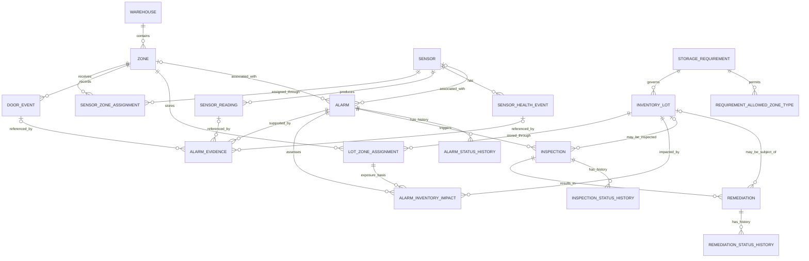

# ColdWatch AI — Entity Relationship Design

## 1. Design objective

This ERD models warehouse structure, environmental telemetry, inventory storage history, risk decisions, and operational follow-up. The ten challenge entities remain the core model. Supporting tables are added only where they are needed for many-to-many relationships, effective-dated assignments, evidence, or append-only state history.

All timestamps are stored in UTC. IDs are immutable business identifiers using the challenge's naming conventions.

## 2. Entity relationship diagram

> Mermaid represents the logical relationships. Optional foreign keys and conditional evidence constraints are described below and enforced in the SQL schema/application validation.

## 3. Core entities and keys

| Entity | Primary key | Required foreign keys | Purpose |
|---|---|---|---|
| Warehouse | `warehouse_id` | — | Physical warehouse facility |
| Zone | `zone_id` | `warehouse_id` | Storage/operating zone within a warehouse |
| Sensor | `sensor_id` | — | Telemetry device identity and configuration |
| SensorReading | `reading_id` | `sensor_id` | One measurement captured by a sensor |
| DoorEvent | `door_event_id` | `zone_id` | Door OPEN/CLOSE event in a zone |
| InventoryLot | `lot_id` | `requirement_id` | Product batch with a defined storage requirement |
| StorageRequirement | `requirement_id` | — | Effective-dated environmental limits for a product |
| Alarm | `alarm_id` | `zone_id` optional; `sensor_id` optional | Detected environmental, operational, or data-quality risk |
| Inspection | `inspection_id` | `alarm_id`; `lot_id` optional | Investigation of an alarm, optionally for a specific lot |
| Remediation | `remediation_id` | `inspection_id`; `lot_id` optional | Corrective action arising from an inspection |

## 4. Supporting tables

| Supporting table | Primary key | Foreign keys | Why it exists |
|---|---|---|---|
| SensorZoneAssignment | `assignment_id` | `sensor_id`, `zone_id` | Effective-dated sensor-to-zone mapping; preserves relocation history and permits mapping exceptions to be detected |
| RequirementAllowedZoneType | Composite: `requirement_id`, `zone_type` | `requirement_id` | Stores the allowed zone types for a storage requirement without putting a list in one field |
| LotZoneAssignment | `assignment_id` | `lot_id`, `zone_id` | Effective-dated lot location and dwell-time history; supports lot movement and split storage |
| SensorHealthEvent | `health_event_id` | `sensor_id` | Explicit outage, drift, or sensor-health incident |
| AlarmEvidence | `evidence_id` | `alarm_id`; exactly one of `reading_id`, `door_event_id`, `health_event_id` | Traceable source evidence supporting an alarm |
| AlarmInventoryImpact | `impact_id` | `alarm_id`, `lot_id`, `lot_zone_assignment_id` | Many-to-many alarm/lot impact, with the assignment interval used to prove exposure |
| AlarmStatusHistory | `history_id` | `alarm_id` | Append-only alarm state transitions |
| InspectionStatusHistory | `history_id` | `inspection_id` | Append-only inspection state transitions |
| RemediationStatusHistory | `history_id` | `remediation_id` | Append-only remediation state transitions |

Ground-truth labels are deliberately **not** stored in the operational tables above. They are exported to a separate `data/ground_truth/` artifact and consumed only by the evaluator.

## 5. Cardinality and optionality

| Relationship | Cardinality | Optionality / rule |
|---|---|---|
| Warehouse → Zone | 1:N | Every zone belongs to exactly one warehouse; a warehouse may have many zones |
| Sensor ↔ Zone | N:M over time | Implemented by SensorZoneAssignment; a sensor can move between zones. Overlapping assignments require an approved rationale |
| Sensor → SensorReading | 1:N | Every reading belongs to exactly one sensor |
| Zone → DoorEvent | 1:N | Every door event belongs to exactly one zone |
| Sensor → SensorHealthEvent | 1:N | A sensor may have zero or many health events |
| StorageRequirement → InventoryLot | 1:N | Every lot references one applicable requirement version |
| StorageRequirement → allowed zone types | 1:N | A requirement can allow one or more zone types |
| InventoryLot ↔ Zone | N:M over time | Implemented by LotZoneAssignment; records entry, exit, quantity and dwell time |
| Zone/Sensor → Alarm | 1:N, optional on Alarm | A zone- or sensor-specific alarm may reference either or both; system-level alarms may reference neither |
| Alarm → AlarmEvidence | 1:N | Evidence may be readings, door events, or sensor-health events |
| Alarm ↔ InventoryLot | N:M | Implemented by AlarmInventoryImpact; a lot can be impacted by multiple alarms |
| Alarm → Inspection | 1:N | An alarm may require zero or many inspections |
| Inspection → Remediation | 1:N | An inspection may result in zero or many corrective actions |
| Alarm/Inspection/Remediation → status history | 1:N | Every state change is appended; prior states are not overwritten |

## 6. Important modelling decisions

1. **No direct `zone_id` on Sensor:** SensorZoneAssignment is the authoritative mapping so that moves and mapping exceptions remain traceable.
2. **No direct `zone_id` on InventoryLot:** LotZoneAssignment is authoritative because lots can move and may be split across zones.
3. **Requirement versioning:** StorageRequirement has an effective date range and version. A lot references the requirement version applicable to it.
4. **Occupancy unit:** For this synthetic prototype, occupancy is represented as a percentage (0–100%) of zone capacity. The zone stores its warning limit. This is an explicit modelling assumption, not a value prescribed by the challenge.
5. **Door master:** The challenge does not require a separate Door entity. DoorEvent stores a stable `door_id` within its zone and references the zone.
6. **Alarm evidence:** An AlarmEvidence row references exactly one evidence source. This is enforced with a check constraint and foreign keys.
7. **Inventory impact is not disposition:** An exposed lot is marked as potentially affected / requiring assessment. Only the quality workflow can release, quarantine, or dispose of it.
8. **Missing observations:** A missing sensor reading is not a normal reading. The detection process derives a monitoring gap and persists a SensorHealthEvent.
9. **Ground truth separation:** Scenario labels and expected outcomes are stored separately from detector inputs to avoid label leakage.

## 7. Effective-date convention

All time intervals use a half-open convention: `[valid_from, valid_to)`.

- Start is inclusive.
- End is exclusive.
- A NULL end timestamp means the assignment is currently open.
- End timestamps must be greater than start timestamps.
- Exposure overlap is true when `assignment_start < alarm_end` and `assignment_end > alarm_start`, treating a NULL end as an open interval.

## 8. Lifecycle-history convention

The current status may be stored on Alarm, Inspection, and Remediation for efficient filtering. Each transition must also append a corresponding history row containing:

- Previous status (NULL only for the initial transition).
- New status.
- Changed timestamp.
- Actor/system identifier.
- Reason or note.

History rows are immutable. A current-status update and its history insert must be performed in one transaction.

## 9. Validation boundaries

Database constraints should enforce primary keys, foreign keys, required fields, valid numeric ranges, allowed enums, and simple date ordering. Cross-row temporal overlap, approved sensor mapping rationale, complete alarm-to-lot impact, lifecycle transition legality, and detection correctness require explicit validation queries / Python validators.
